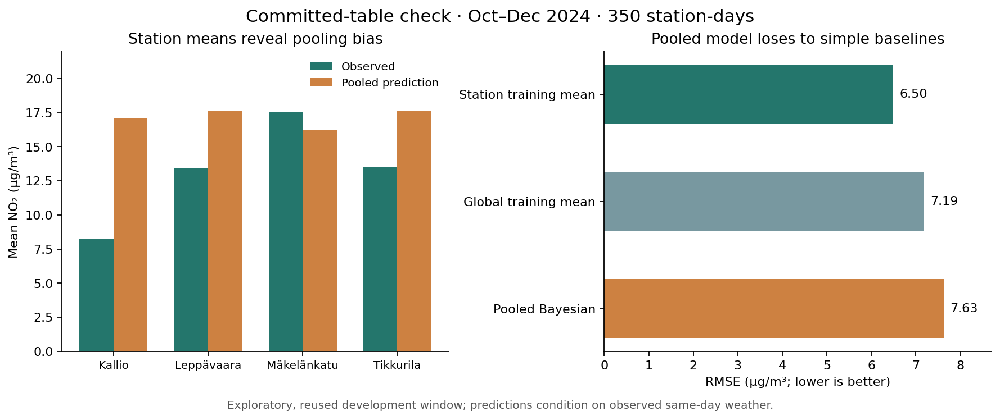

# Minh's pooled model: report and presentation notes

The pooled benchmark is implemented and evaluated on real 2024 observations. Sampling is reliable, but winter prediction is weak. These results are exploratory: numerical priors, source semantics and the final shared comparison have not been approved by the group.

## My technical contribution

I fit Model A to ask whether weekend status is associated with daily NO₂ after adjustment for wind, temperature, rainfall and annual seasonality. Every station shares one intercept and common effects. Andrei owns Model B, which can represent station differences; Ayreeen owns preprocessing and the final comparison. Each person explains their own technical work in the report and presentation.

## Model and preparation

For station-day i:

`NO₂_i ~ LogNormal(eta_i, sigma)`

`eta_i = alpha + beta_weekend*weekend_i + beta_wind*wind_i + beta_temperature*temperature_i + beta_rain*rain_i + beta_sin*sin_i + beta_cos*cos_i`.

The model requires positive daily concentrations. Weekends are Saturday/Sunday. Wind is scaled per 2 m/s, temperature per 10°C and daily rainfall per 1 mm; continuous variables use training-only centers. Annual sine/cosine terms have a 366-day period for 2024. Arithmetic mean predictions use `exp(eta + sigma²/2)`.

The latest committed `data/processed/step3_analysis_table.csv`, as present at main commit `82ba18b`, contains 1,464 station-days. The diagnostic keeps `usable_day=True`, positive NO₂ and finite values for all model inputs: **1,441 rows**, comprising Kallio 353, Leppävaara 365, Mäkelänkatu 364 and Tikkurila 359. It preserves supplied dates and measurements exactly, with no imputation. This selection does not independently validate the preprocessing.

Earlier investigations used a **separately reconstructed 1,440-row cohort**, shifting hourly end labels back one hour before assigning Helsinki dates, consistent with [FMI's observation guidance](https://en.ilmatieteenlaitos.fi/guidance-to-observations). This produces different daily values and exclusions. The ablations below apply to that earlier cohort, not the latest committed table. Both versions use the daily mean of supplied hourly **maximum** wind measurements, not ordinary mean wind speed. The discrepancy in date aggregation is recorded for the preprocessing owner; teammates' source files are preserved.

## Provisional priors and prior checks

Numerical choices are analyst assumptions recorded in [baseline-priors.json](pooled-evaluation/baseline-priors.json), with `approved:false`:

- Intercept: Normal(log(20), 0.75); residual sigma: HalfNormal(0.5).
- Central 95% concentration-ratio ranges: weekend [0.5, 2], wind [0.5, 1.5], temperature [0.5, 2], rainfall [0.9, 1.1], each seasonal coefficient [0.25, 4]. These ranges determine Normal slope means/SDs using the project's ratio conversion.
- Prior predictive simulation on the committed-table training design gives a median around 20.2, 99th percentile 372.7 and 99.9th percentile 1,079.6 µg/m³. The upper tail is broad and needs scientific review; it is not marked accepted.

The exploratory scripts call the model API with provisional priors explicitly allowed. They never mark real data synthetic or fabricate approval. The production CLI still requires the actual data/prior review records described in [models/README.md](../models/README.md).

## Actual fitting and weekend association

Fits use four chains, 1,000 warmup and 1,000 retained draws per chain, target acceptance 0.9 and seed 20261122. The full committed-cohort fit has zero divergences, worst rank R-hat **1.0029**, minimum bulk ESS **2,483** and minimum tail ESS **2,499**. The training-only and widened-prior fits also pass all configured sampling checks.

On the full committed cohort, the posterior median of `exp(beta_weekend)` is **0.704**, with 95% credible interval **[0.666, 0.740]**: approximately **29.6% lower** conditional median concentration on weekends. All 4,000 retained draws have a negative weekend coefficient; that Monte Carlo fraction does not prove a probability of exactly one.

Doubling all six slope prior SDs gives ratio **0.702 [0.666, 0.740]**, a small change. The separately reconstructed cohort gives baseline **0.700 [0.666, 0.736]** and widened-prior **0.699 [0.663, 0.735]**.

These are associations conditional on the specified model, not causal traffic effects. The pooled model cannot estimate station-specific weekend effects. Residual dependence and predictive failures below also mean that numerical stability under prior widening does not establish calibrated scientific uncertainty.

## Prediction on the committed table

Train before 1 October 2024: **1,091 rows**. Evaluate October–December: **350 rows**, keeping all stations on a date together. Predictions condition on observed same-day weather. Q4 has already been used during investigation, so these are development diagnostics rather than an independent final test.

| Point prediction | MAE (µg/m³) | RMSE (µg/m³) |
| --- | ---: | ---: |
| Pooled Bayesian arithmetic mean | 6.04 | 7.63 |
| Global training mean | 5.88 | 7.19 |
| Station-specific training mean | 5.05 | 6.50 |

The pooled model underperforms both simple baselines. Its nominal 95% predictive intervals cover **90.3%** of test observations, with mean width **30.49 µg/m³** and mean log predictive density **−3.307**. Kallio is particularly poor: RMSE **10.19**, MAE **9.05**, coverage **74.1%**. Passing MCMC checks does not fix this predictive mismatch.

## Bottlenecks tested on the reconstructed cohort

The earlier cohort has 1,091 training and 349 Q4 rows. Its original pooled RMSE is 7.63, confirming that the latest-table result is not an isolated sampling failure. Four expanding monthly folds for June–September contain 488 validation station-days; transformations are always fitted on training dates.

| Bayesian diagnostic | June–September RMSE | Reused Q4 RMSE |
| --- | ---: | ---: |
| Original pooled model | 5.32 | 7.63 |
| Pooled, regularized seasonal terms | 5.05 | 6.59 |
| Station offsets + regularized seasonal terms | 4.00 | 5.97 |
| Pooled, annual terms removed | 5.02 | 5.97 |

All 20 ablation fits pass the configured sampling checks. Regularization changes seasonal Normal SDs from approximately 0.707 to 0.05. Station offsets use fixed Normal(0, 0.5) priors; this is a diagnostic experiment, not Andrei's hierarchical model. The station-offset/regularized version improves aggregate RMSE by 24.9% on earlier folds and 21.7% on reused Q4, improving each earlier monthly fold.

The main limitations are structural:

- **Station baselines:** Kallio and Leppävaara share weather inputs, so this fully pooled equation must give identical predictions on paired dates despite differing pollution levels.
- **Seasonal extrapolation:** training temperature and annual cosine correlate about −0.887. Their separate effects are difficult to extrapolate from part of one annual cycle. Shrinkage helps aggregate scores but does not establish a scientifically correct prior.
- **Time dependence:** even the station-offset/regularized experiment retains training one-day residual correlations around 0.42–0.56. More MCMC draws cannot repair omitted temporal structure.

These experiments explain the benchmark's weakness and give concrete evidence for the team's station-aware comparison. They do not justify selecting a final model solely on already examined windows. Final data semantics, prior elicitation and common splits still require the actual team decision; all investigated windows are development evidence.

## My presentation

1. Explain the pooled equation and shared station assumptions.
2. Show the provisional priors and the broad prior-predictive tail.
3. Present the weekend association, sensitivity and conditional uncertainty.
4. Show the predictive figure: reliable sampling, weak winter prediction.
5. Explain the station/season/time bottlenecks and hand over to Model B and the team's comparison.

[Reproduction commands](../analysis/pooled/README.md) · [Evidence index](pooled-evaluation/README.md).
